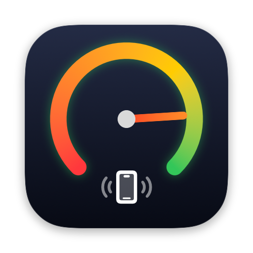
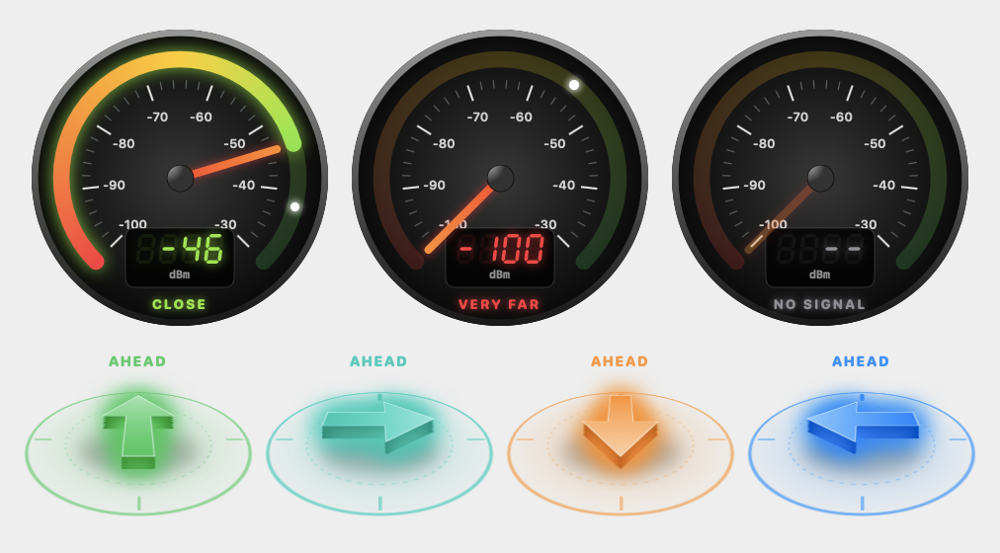

<p align="center">
  
</p>

<h1 align="center">findphone</h1>

<p align="center">
  <b>Find your own iPhone in a room using your Mac's Bluetooth signal strength.</b><br>
  A native macOS app (SwiftUI) and command-line tool built only with Apple frameworks.
</p>

<p align="center">
  <a href="https://gopal089.github.io/findphone/"><b>▶ Try the live demo</b></a> ·
  <a href="https://github.com/gopal089/findphone/releases/latest"><b>⬇ Download for Mac</b></a>
</p>

<p align="center">
  
</p>

---

## What it does

findphone measures the Bluetooth Low Energy signal strength (RSSI) of a device **you own** and turns it into a "warmer / colder" search:

- **Digital speedometer** – a dashboard dial from -100 dBm (far) to -30 dBm (very close) with a springy needle, a strongest-reading marker and glowing seven-segment digits.
- **3D direction arrow** – tells you to keep going, turn around, or which way to face.
- **Find direction sweep** – turn on the spot in four quarter-turns; findphone compares the signal in each direction (your body blocks some signal from behind you) and points to the strongest one, with a confidence rating.
- **Geiger-counter clicks** – optional sound that speeds up from 1 click/s at -95 dBm to 14 clicks/s at -50 dBm and goes silent when the signal is lost.
- **Beacon mode** – lets a phone app find the Mac (groundwork for an iPhone companion app).

## Safety and privacy by design

- **Owned devices only.** Searching requires an explicit "This device is mine" confirmation (`--owned` on the command line). Changing the device name un-confirms it.
- **Never pairs.** findphone makes a plain link-only connection to read RSSI. It never discovers services or reads characteristics, which is what can trigger pairing.
- **No identifiers on screen.** The app never shows Bluetooth identifiers or addresses. The CLI has a `--redact` flag that hides every name, UUID and address before you share output.
- **Nothing stored.** No scan results are written to disk.

## How it works

| Step | Detail |
|---|---|
| Measure | `CoreBluetooth` scans with duplicate reporting, then connects (link only) and calls `readRSSI()` every 0.3 s. |
| Clean | Readings outside -126…-1 dBm are rejected; the display shows the **median of the 7 newest** readings. |
| Trend | Median of the last 3 s vs the 3 s before: ±3 dB or more means closer / farther. |
| Direction | Guided 4-way sweep, 5 s of readings per direction; best median wins if it beats the runner-up by ≥3 dB ("likely") or ≥6 dB ("strong"). |
| Fallback | For an already-paired device, the CLI can read macOS's reported RSSI via `system_profiler SPBluetoothDataType -json`. |

> Bluetooth RSSI shows **proximity, not exact distance or direction**. Macs have no Ultra-Wideband chip, so findphone estimates direction from signal trends and body shadowing. For a phone that is truly lost, use Apple's Find My.

## Project structure

```
Package.swift                 Swift Package for the command-line tool
Sources/findphone/            CLI: survey, hunt, --list, --sound, --redact
Apps/FindPhone.xcodeproj      Xcode project for the Mac app
Apps/Shared/                  Search engine, signal maths, direction logic, gauge & arrow views
Apps/FindPhoneMac/            Mac window, click sound, beacon, paired-device picker
Apps/FindPhoneMacControls/    Control Center button (WidgetKit control)
Apps/Intents/                 App Intent behind the Control Center button
docs/                         Live demo page (GitHub Pages)
```

## Build and run

Requirements: macOS 13 or later, Xcode 16 or later, a Mac with Bluetooth.

**Mac app**

```bash
xcodebuild -project Apps/FindPhone.xcodeproj -target FindPhone -configuration Release build
open Apps/build/Release/FindPhone.app
```

Pick your device from **Paired devices**, tick **This device is mine**, then press **Start search**.

**Command-line tool**

```bash
swift run findphone                                   # survey nearby BLE devices (listen only)
swift run findphone --list                            # list paired devices (read only)
swift run findphone "Exact Device Name" --owned       # hunt for one device you own
swift run findphone "Exact Device Name" --owned --sound --redact
```

## Tech

Swift · SwiftUI · CoreBluetooth · AudioToolbox · WidgetKit · App Intents · Swift Package Manager · Xcode project with file-system-synchronized groups. No third-party dependencies.

## Known limitations

- Works within Bluetooth range (roughly 10–30 m indoors) and only while the device's Bluetooth is on.
- The Control Center button builds and appears, but doesn't launch a search on ad-hoc-signed builds; it likely needs Developer ID signing.
- The downloadable app is not notarized: on first launch, right-click it and choose **Open**.
